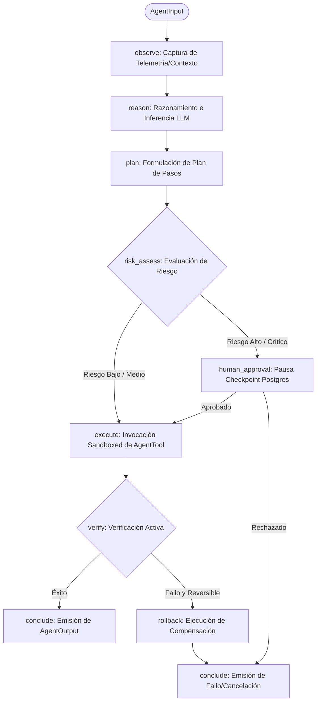

# Arquitectura de `jg_agente` (Execution Plane)

> **Estado del Documento:** ESPECIFICACIÓN TÉCNICA VIVA  
> **Versión:** 2.3.0  
> **Componente:** `jg_agente` — Execution Plane  

---

## 1. Misión y Alcance

`jg_agente` es el **Execution Plane** (motor autónomo de ejecución desacoplado) de la plataforma de IA. Su propósito exclusivo es ejecutar tareas cognitivas de razonamiento, planificación, acción y verificación orientadas a objetivos mediante grafos de estados ([LangGraph](https://github.com/langchain-ai/langgraph)), ejecutándose como un proceso aislado dentro de una red privada.

### Principios Arquitectónicos No Negociables

1. **Agnosticismo Radical del Core:**
   El Core de `jg_agente` no posee conocimiento de dominios particulares (DevOps, telefonía, finanzas, CRM). Queda terminantemente prohibido el uso de bifurcaciones condicionales basadas en el tipo de agente:
   ```python
   # PROHIBIDO EN EL CORE:
   if agent_type == "conversational": ...
   if is_devops: ...
   ```
   Toda funcionalidad especializada se suministra exclusivamente vía **Plugins** cargados dinámicamente mediante `CapabilityRegistry`.

2. **Ausencia Absoluta de Adaptadores de Transporte:**
   `jg_agente` **NO conoce ni implementa interfaces de usuario o comunicación externa** (Asterisk, Telegram, WhatsApp, Slack, Webhooks propietarios).
   - Toda entrada al agente es un [`AgentInput`](models.md#agentinput).
   - Toda salida del agente es un [`AgentOutput`](models.md#agentoutput).
   - Todos los protocolos, clientes y adaptadores de transporte pertenecen a `jg_dashboard` o a gateways perimetrales.

3. **Separación Estricta de Planos (Execution Plane vs. Control Plane):**
   - **Control Plane (`jg_dashboard`):** Gestión de usuarios, autenticación (JWT), control de acceso basado en roles (RBAC), catálogo de agentes, consola de intervención humana (HITL) y adaptadores de canales.
   - **Execution Plane (`jg_agente`):** Grafo de inferencia LangGraph, registro de plugins, sandboxing de herramientas, persistencia local de checkpoints y auditoría inmutable.
   - **Aislamiento de Persistencia:** `jg_dashboard` **NUNCA** se conecta a la base de datos de `jg_agente`. Toda comunicación es vía API REST autenticada mediante tokens emitidos durante el handshake de registro.

---

## 2. Matriz de Responsabilidades

| Responsabilidad | Core (`jg_agente`) | Plugins (`jg_plugin_*`) | Dashboard (`jg_dashboard`) |
| :--- | :--- | :--- | :--- |
| **Orquestación del Grafo** | **Exclusiva** (LangGraph) | Prohibida | Invocación remota vía API |
| **Modelos de Entrada/Salida** | Define `AgentInput`/`AgentOutput` | Consume contratos | Normaliza entradas externas |
| **Herramientas de Negocio** | Provee contrato `AgentTool` | **Implementa Tools** | Solo visualiza metadata |
| **Engines de Ciclo** | Define interfaces abstractas | Implementa engines concretos | Ninguna |
| **Evaluación de Riesgo** | `SecurityGuard` (Políticas) | Declara metadata de riesgo | Visualiza y aprueba (HITL) |
| **Rollback de Operaciones** | Ejecuta compensaciones | Declara `rollback_func` | Ninguna |
| **Persistencia de Checkpoints** | Tablas `core_*` | Tablas prefijadas `plugin_*` | Tablas propias (DB separada) |
| **Auditoría de Seguridad** | `SecurityAuditLogger` | Provee telemetría de tools | Agrega reportes de auditoría |
| **Gestión de Identidad/Usuarios** | Ninguna (solo API keys internas) | Ninguna | **Exclusiva** (JWT, RBAC) |

---

## 3. Ciclo Cognitivo de Ejecución



### Ensamblado en Tiempo de Arranque (Boot)
El grafo de LangGraph no se evalúa dinámicamente en cada petición, sino que se ensambla una sola vez al arrancar el agente en función de las capacidades registradas:
1. **Nodos Obligatorios:** `reason`, `execute`, `conclude`.
2. **Nodos Condicionales:**
   - Si existe un `ObserverEngine` registrado → se enlaza el nodo `observe` antes de `reason`.
   - Si existe un `PlannerEngine` registrado → se enlaza el nodo `plan` tras `reason`.
   - Si las herramientas planificadas declaran `RiskLevel >= HIGH` → se interceptan con `risk_assess` y `human_approval`.
   - Si existe un `VerifierEngine` registrado → se enlaza el nodo `verify` tras `execute`.
   - Si una herramienta falla y es reversible (`reversible=True`) → se deriva al nodo `rollback`.
