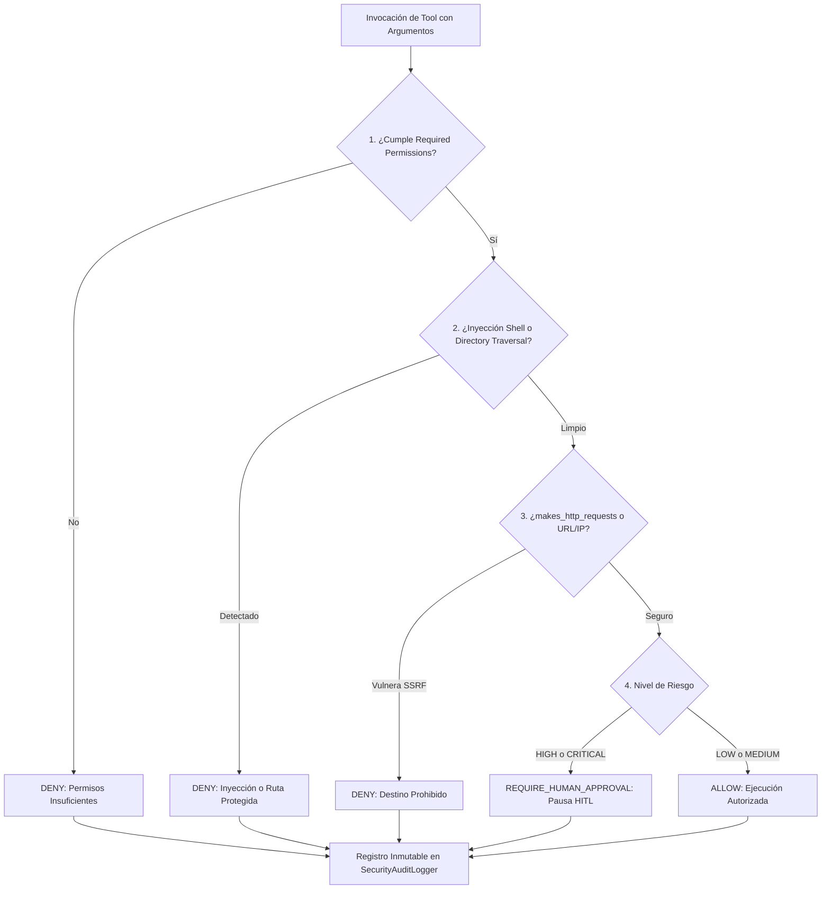

# Seguridad, Políticas y Auditoría Inmutable

> **Estado del Documento:** ESPECIFICACIÓN TÉCNICA VIVA  
> **Versión:** 2.3.0  
> **Módulo:** `app.security`  

---

## 1. Principio Fundamental de Seguridad

> **La seguridad de `jg_agente` no depende únicamente de filtros sintácticos o blacklists de comandos.**

El Execution Plane implementa un modelo de defensa en profundidad donde cada estímulo, decisión de riesgo y ejecución de herramienta es evaluado y auditado de forma determinista antes de su ejecución física sobre el entorno.

---

## 2. Decisiones de Seguridad Formals (`SecurityEvaluationResult`)

Toda evaluación previa a la invocación física genera un resultado tipado e inmutable:

```python
class PolicyDecision(StrEnum):
    ALLOW = "allow"
    DENY = "deny"
    REQUIRE_HUMAN_APPROVAL = "require_human_approval"


class SecurityEvaluationResult(BaseModel):
    decision: PolicyDecision
    operation: str
    target_resource: str
    risk_level: RiskLevel
    reason: str
    required_permissions: list[str]
    is_reversible: bool
    can_cause_data_loss: bool
    evaluated_at: datetime
```

---

## 3. Servicio de Auditoría (`SecurityAuditLogger`)

El servicio [`SecurityAuditLogger`](../app/security/audit.py) es el componente central de trazabilidad y compliance del agente. Registra eventos en memoria y en la tabla `core_audit_records` de PostgreSQL.

### 3.1 Persistencia Asíncrona No Bloqueante
- Los registros se despachan como tareas en segundo plano (`asyncio.create_task`) utilizando la factoría de sesiones asíncronas de SQLAlchemy (`async_session_factory`).
- Se mantiene un registro en `_pending_tasks` para prevenir recolección prematura por el Garbage Collector.
- El método `await audit.flush()` permite esperar la sincronización de todas las tareas en vuelo antes del cierre o de emitir respuestas finales.

### 3.2 Atributos Obligatorios por Evento
Cada registro de auditoría persiste estructurado con los siguientes cuatro metadatos esenciales:
1. **`timestamp`**: Marca temporal UTC de alta precisión.
2. **`actor`**: Identificador del usuario autenticado, subagente o subsistema responsable (`security_guard`, `tool_executor`, `orchestrator`, `user_id`).
3. **`risk_level`**: Nivel de riesgo formal (`low`, `medium`, `high`, `critical`).
4. **`result`**: Resultado o veredicto de la operación (`allow`, `deny`, `success`, `failed`, `transitioned`, `approved`).

### 3.3 Métodos Semánticos de Registro
- `record_stimulus(input_data: AgentInput)`: Registra la recepción de un estímulo externo.
- `record(evaluation: SecurityEvaluationResult)`: Registra veredictos del subsistema de políticas de seguridad.
- `record_tool_execution(...)`: Registra duración, éxito, argumentos y contexto de rollback de una herramienta.
- `record_state_transition(...)`: Registra cambios de estado del ciclo operacional.
- `record_approval(...)`: Registra solicitudes y decisiones de intervención humana (HITL).
- `record_event(...)`: Registro de eventos estructurados genéricos.

### 3.4 Resiliencia ante Claves Foráneas Desacopladas
Si se audita una acción con un `execution_id` que aún no existe en `core_executions` (ej. en flujos efímeros o evaluaciones previas al registro de ejecución), el logger captura la excepción de clave foránea e inserta el registro con `execution_id=None`, preservando el identificador dentro de `details["unlinked_execution_id"]` para asegurar que **ninguna traza de auditoría se pierda jamás**.

---

## 4. Protección contra Server-Side Request Forgery (SSRF)

El módulo [`SSRFValidator`](../app/security/ssrf.py) protege al Execution Plane contra peticiones no autorizadas hacia recursos internos, interfaces de administración y metadatos de proveedores de nube.

### 4.1 Rangos y Destinos Bloqueados por Defecto
1. **Loopback:** `127.0.0.0/8`, `::1/128`.
2. **Cloud Metadata Services (IMDS):** `169.254.0.0/16`, `fe80::/10` (AWS, GCP, Azure, OpenStack `169.254.169.254`).
3. **Redes Privadas (RFC 1918 / RFC 4193):** `10.0.0.0/8`, `172.16.0.0/12`, `192.168.0.0/16`, `fc00::/7`.
4. **Hostnames Protegidos:** `localhost`, `metadata.google.internal`, `*.local`, `*.internal`.
5. **Esquemas No Autorizados:** Se bloquean esquemas arbitrarios (`file://`, `ftp://`, `gopher://`), autorizando exclusivamente `http` y `https`.

### 4.2 Defensa en Profundidad para `AgentTool`
- **Declaración:** Las herramientas declaran explícitamente `makes_http_requests=True` en su contrato.
- **Inspección de Argumentos (`validate_tool_arguments_for_ssrf`):** Escanea argumentos de entrada generados por LLMs detectando URLs o IPs privadas embebidas.
- **Resolución DNS y Anti-Rebinding:** Resuelve los nombres de dominio a sus direcciones IP físicas y verifica cada una de ellas contra las listas de redes bloqueadas.
- **Allowlists Configurables:**
  - `SSRF_ALLOWED_HOSTS`: Dominios o comodines autorizados (ej. `*.cabocom.net`, `api.github.com`).
  - `SSRF_ALLOWED_NETWORKS`: Subredes CIDR explícitamente autorizadas para integraciones internas (ej. `10.200.0.0/24`).
  - `SSRF_ALLOW_PRIVATE_NETWORKS`: Flag opcional de entorno para permitir redes RFC 1918 sin desbloquear jamás loopback ni cloud metadata.

---

## 5. Interceptor de Ejecución (`SecurityGuard`)

[`SecurityGuard`](../app/security/guard.py) es el interceptor central y sandbox de ejecución de `jg_agente`. Interpone una barrera determinista entre las decisiones del LLM y la invocación física de herramientas sobre el entorno.

### 5.1 Pipeline de Evaluación (`evaluate`)



### 5.2 Interceptor Asíncrono de Ejecución (`execute_tool`) (ISSUE-AGENT-004)
1. **Decisión `DENY`:** Devuelve `ToolResult(success=False, error="SecurityGuard DENY...")` **sin invocar `func`**.
2. **Decisión `REQUIRE_HUMAN_APPROVAL`:** Devuelve `ToolResult(success=False, requires_approval=True...)` **sin invocar `func`**, señalizando al orquestador LangGraph que debe pausarse en el checkpointer.
3. **Decisión `ALLOW`:**
   - Sanitiza entradas (`sanitize_arguments`: remueve caracteres nulos y normaliza espacios).
   - **Imposición de `timeout_sec`:** Envuelve la invocación bajo `asyncio.wait_for(..., timeout=tool.timeout_sec)`.
   - **Ejecución No Bloqueante de Herramientas Síncronas:** Las funciones síncronas se despachan a un hilo worker mediante `asyncio.to_thread(_invoke_sync)` para evitar bloquear el bucle de eventos o congelar los workers del agente.
   - **Manejo de `TimeoutError`:** Si la herramienta supera `tool.timeout_sec`, captura la excepción, registra el fallo en `SecurityAuditLogger` y retorna `ToolResult(success=False, error="TimeoutError: ...", metadata={"timed_out": True})`.
   - Si la herramienta culmina exitosamente, registra el evento `tool_executed` en el `SecurityAuditLogger` con la duración exacta (`duration_ms`) y retorna el `ToolResult`.

---

## 6. Autenticación y Anti-Replay en Execution Plane (GLOBAL-001 / ISSUE-AGENT-001)

Para garantizar que únicamente el Control Plane autorizado (`jg_dashboard`) pueda disparar o alterar ejecuciones cognitivas en el agente, los endpoints de `executions_router` implementan verificación estricta de firma criptográfica HMAC-SHA256 con anti-replay:

### 6.1 Cabeceras de Verificación
- `X-Signature`: Firma hexadecimal calculada con el secreto permanente del agente.
- `X-Timestamp`: Unix timestamp del momento de la emisión.
- `X-Agent-ID`: Identificador único del agente que debe coincidir con `AGENT_ID` del entorno.

### 6.2 Reconstrucción de la Petición Canónica
El agente reconstruye determinísticamente la cadena canónica leyendo los bytes raw de la petición:
```text
canonical_string = METHOD\nPATH\nTIMESTAMP\nSHA256(RAW_BODY)
```
- `METHOD`: Método HTTP en mayúsculas (`POST`, `GET`).
- `PATH`: Ruta canónica normalizada (ej. `/executions/trigger`).
- `TIMESTAMP`: Valor del timestamp provisto en `X-Timestamp`.
- `SHA256(RAW_BODY)`: Hash SHA-256 de los bytes exactos recibidos en el payload HTTP (o hash de cadena vacía si no hay cuerpo).

### 6.3 Validaciones de Seguridad
1. **Presencia de Cabeceras:** Ausencia de `X-Signature`, `X-Timestamp` o `X-Agent-ID` rechaza con `401 Unauthorized`.
2. **Ventana Anti-Replay:** Si $|T_{\text{actual}} - T_{\text{header}}| > 300\text{ s}$ (5 minutos), la petición es rechazada inmediatamente con `401 Unauthorized` (`Timestamp fuera de la ventana permitida`).
3. **Correspondencia de Agente:** Si `X-Agent-ID` no coincide con el `AGENT_ID` configurado en el agente, se rechaza con `401 Unauthorized`.
4. **Verificación en Tiempo Constante:** La firma calculada se compara con `X-Signature` mediante `hmac.compare_digest` para prevenir ataques de canal lateral (timing attacks). La alteración de un solo byte en el cuerpo, ruta, método o timestamp invalida la firma.
