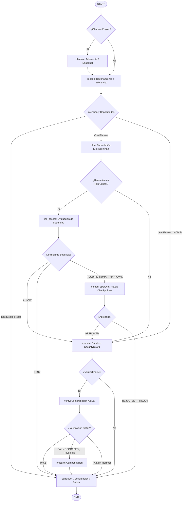

# Ensamblado Agnóstico del Grafo LangGraph (`GraphBuilder`)

> **Estado del Documento:** ESPECIFICACIÓN TÉCNICA VIVA  
> **Versión:** 1.0.0  
> **Componente:** `jg_agente.core.graph` — GraphBuilder  

---

## 1. Propósito y Principio de Agnosticismo

El componente `GraphBuilder` (`app/core/graph.py`) es el ensamblador agnóstico del grafo de estados ([LangGraph](https://github.com/langchain-ai/langgraph)) para `jg_agente`. Su misión es compilar una máquina de estados `StateGraph[AgentState]` conectando condicionalmente nodos y aristas en tiempo de arranque (**Boot time**) a partir de la introspección estricta de las capacidades registradas en [`CapabilityRegistry`](plugins.md).

### Regla de Oro
**Queda terminantemente prohibido el acoplamiento a tipos de agente o dominios específicos:**
```python
# PROHIBIDO EN EL CORE:
if agent_type == "conversational":
    ...
if is_devops:
    ...
```

La topología del grafo es determinada 100% por capacidades disponibles:
- Si hay un `ObserverEngine` registrado → se enlaza el nodo `observe` (`START -> observe -> reason`).
- Si hay un `PlannerEngine` registrado → se enlaza el nodo `plan` (`reason -> plan -> ...`).
- Si hay herramientas registradas con `RiskLevel.HIGH` o `CRITICAL` → se enlazan `risk_assess` y `human_approval`.
- Si hay un `VerifierEngine` registrado → se enlaza `verify` tras `execute`.
- Si hay herramientas con `reversible=True` → se enlaza `rollback` ante fallos de verificación.
- Nodos canónicos troncales obligatorios: `reason`, `execute`, `conclude`.

---

## 2. Topología Cognitiva y Enrutamiento



---

## 3. Contratos de Nodos Canónicos

| Nodo | Obligatoriedad | Condición de Inclusión | Descripción |
| :--- | :--- | :--- | :--- |
| `observe` | Condicional | `registry.get_observer() is not None` | Captura telemetría y puebla `environment_snapshot`. |
| `reason` | **Obligatorio** | Siempre presente | Evalúa el estímulo (`AgentInput`), mensajes e intención (`IntentModel`). |
| `plan` | Condicional | `registry.get_planner() is not None` | Descompone la intención en una secuencia ordenada de `PlanStep`. |
| `risk_assess` | Condicional | `has_high_risk_tools` o `has_planner` | Evalúa el riesgo del plan contra políticas del `SecurityGuard`. |
| `human_approval` | Condicional | `has_high_risk_tools` | Pausa de ejecución HITL en el checkpointer. |
| `execute` | **Obligatorio** | Siempre presente | Invoca herramientas bajo el sandbox `SecurityGuard.execute_tool()`. |
| `verify` | Condicional | `registry.get_verifier() is not None` | Inspección activa de efectos y actualización de `verification_results`. |
| `rollback` | Condicional | `has_reversible_tools` | Ejecuta compensaciones en orden inverso (`tool.rollback()`). |
| `conclude` | **Obligatorio** | Siempre presente | Consolida estado resolutivo (`AgentExecutionStatus.RESOLVED`/`FAILED`). |

---

## 4. Persistencia y `StateSnapshot`

LangGraph requiere un checkpointer para soportar consultas de estado e interrupciones HITL. `GraphBuilder.build()` garantiza que:
1. Si no se provee un checkpointer explícito (`checkpointer=None`), inicializa de manera transparente un `MemorySaver()`.
2. Si se suministra un `PostgresSaver`, persiste en las vistas `core_checkpoints` en PostgreSQL.
3. Todo grafo compilado soporta `graph.get_state(config)` retornando un `StateSnapshot` válido con el estado operacional (`status`, `environment_snapshot`, `execution_records`, `is_resolved`).

### Ejemplo de Uso

```python
from app.core import CapabilityRegistry, GraphBuilder, get_postgres_checkpointer
from app.models import AgentInput

# 1. Obtener registro de capacidades
registry = CapabilityRegistry()
# ... registrar plugins, tools y engines ...

# 2. Ensamblar y compilar el grafo
builder = GraphBuilder(registry)
graph = builder.build(interrupt_before=["human_approval"])

# 3. Invocar con hilo conversacional
config = {"configurable": {"thread_id": "thread-sre-01"}}
state = await graph.ainvoke(
    {"request": AgentInput(execution_id="e1", thread_id="t1", prompt="Reiniciar nodo")},
    config=config,
)

# 4. Inspeccionar snapshot persistido
snapshot = await graph.aget_state(config)
print("Estado snapshot:", snapshot.values["status"])
```

---

## 5. Nodo Cognitivo Troncal: `reason`

El nodo `reason` (`app/nodes/reason.py`) actúa como el centro de deliberación del agente:

1. **Memoria Conversacional:** Consume `AgentState["messages"]` e inyecta la directriz de sistema (`SystemMessage`) y el estímulo actual (`HumanMessage`).
2. **Tool Binding Dinámico:** Obtiene las herramientas disponibles de `CapabilityRegistry.get_langchain_tools()` y las enlaza al LLM vía `model.bind_tools()`.
3. **Decisión de Flujo Agnóstica:**
   - Si el LLM emite `tool_calls`: Genera un `IntentModel` con `action_type = "act"`, enrutando directamente a `execute`.
   - Si no hay `tool_calls` pero existe un motor de planificación (`PlannerEngine`) y el estímulo es operativo: Genera un `IntentModel` con `action_type = "plan"`, derivando el flujo a `plan`.
   - Si la interacción es un saludo o respuesta conversacional directa: Genera un `IntentModel` con `action_type = "conclude"`, emitiendo la respuesta textual del LLM en `AIMessage`.
4. **Auditoría Estructurada:** Registra cada invocación en `audit_trail` bajo el tipo de evento `reasoning_completed`.

---

## 6. Nodo Actuador Troncal: `execute`

El nodo `execute` (`app/nodes/execute.py`) actúa como el ejecutor físico de herramientas del agente:

1. **Resolución Polimórfica:** Admite pasos estructurados procedentes de un `ExecutionPlan` (`state["plan"]`), llamadas directas `tool_calls` del LLM (`state["intent"]`), o ejecución base de herramientas registradas.
2. **Sandbox y Gobernanza:** Toda invocación física pasa por `SecurityGuard.execute_tool()`, verificando permisos, niveles de riesgo, argumentos de entrada y directivas SSRF. Soporta `bypass_approval` en caso de autorización HITL confirmada (`ApprovalStatus.APPROVED`).
3. **Preservación de Compensación (`rollback_context`):** Toda herramienta reversible deposita su estado en `StepExecutionRecord.rollback_context` para que el nodo posterior `rollback` pueda realizar compensaciones ordenadas.
4. **Contención ante Fallos:** Si un paso falla, se registra `ExecutionError(code="TOOL_EXECUTION_FAILED")` y se aborta la ejecución de pasos dependientes posteriores.
5. **Historial Conversacional (`ToolMessage`):** Genera mensajes `ToolMessage` asociados a cada `tool_call_id` para retroalimentar la memoria del LLM.
6. **Métricas y Auditoría:** Registra `duration_ms` en cada paso y emite un registro `AuditRecord` bajo el evento `execute_completed`.

---

## 7. Nodo Terminal de Síntesis: `conclude`

El nodo `conclude` (`app/nodes/conclude.py`) consolida el desenlace del ciclo cognitivo y emite el contrato formal `AgentOutput`:

1. **Evaluación de Estado Operacional:** Determina si la ejecución concluyó como `AgentExecutionStatus.RESOLVED` / `ExecutionStatus.COMPLETED` (`"completed"`) o `FAILED`.
2. **Síntesis de Respuesta Textual:** Resuelve la respuesta determinista para el invocador a partir del historial `AIMessage`, parámetros de intención o resumen de herramientas.
3. **Cómputo Temporal Preciso:** Calcula `execution_time_ms` a partir de `request.created_at` (wall-clock time) y duraciones agregadas de herramientas.
4. **Construcción de `AgentOutput`:** Genera la instancia canónica de salida con `execution_id`, `thread_id`, `status`, `response`, `data`, `metadata` y `execution_time_ms`.
5. **Persistencia en el Estado:** Almacena el objeto en `state["output"]` para su inspección inmediata en el `StateSnapshot` de LangGraph antes de conectar con el nodo terminal `END`.
6. **Auditoría Inmutable:** Emite el evento `execution_concluded` en `audit_trail`.

---

## 8. Nodo Opcional de Observación: `observe`

El nodo `observe` (`app/nodes/observe.py`) captura telemetría y el estado del entorno de manera desacoplada previo a la invocación del LLM:

1. **Activación Condicional:** Se intercala dinámicamente entre `START` y `reason` únicamente cuando existe un `ObserverEngine` registrado en `CapabilityRegistry`.
2. **Invocación Polimórfica:** Localiza e invoca métodos de observación (`observe`, `discover`, `collect`), admitiendo corrutinas asíncronas o funciones síncronas con o sin inyección de `AgentState`.
3. **Agnosticismo de Infraestructura:** El Core de `jg_agente` no asume ningún esquema de infraestructura propietario; la información capturada se vuelca limpiamente en `state["environment_snapshot"]`.
4. **Resiliencia Operacional:** Las excepciones del motor de observación se capturan con registro de `ExecutionError(component="observe", fatal=False)` sin interrumpir el ciclo de vida del agente.
5. **Auditoría y Métricas:** Emite el evento `observe_completed` en `state["audit_trail"]` con el tiempo de telemetría (`duration_ms`) y las claves detectadas.


