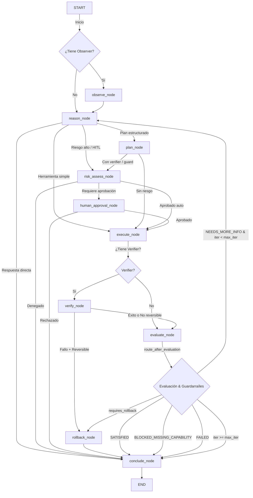

# Análisis Técnico: [LOOP-ISSUE-AGENT-010] Topología cíclica en LangGraph, router de seguridad y erradicación de salidas JSON

## 1. Topología del Grafo LangGraph

### 1.1 Diagrama de Flujo del StateGraph

---

## 2. Guardarraíles Deterministas (`route_after_evaluation`)

La función router `route_after_evaluation(state: AgentState, has_rollback: bool = False) -> str` evaluará en este orden estricto:

1. **Rollback Necesario:**
   Si `state.get("requires_rollback")` y `has_rollback` ➔ `"rollback"`.
2. **Límite de Presupuesto / Iteraciones:**
   Si `int(state.get("iteration", 1)) >= int(state.get("max_iterations", 3))` ➔ `"conclude"`.
3. **Inspección del Veredicto Semántico (`EvaluationRecord`):**
   - Recuperar el último registro: `eval_rec = state.get("evaluation_records", [])[-1]` si existe.
   - Si no hay registros ➔ `"conclude"`.
   - Si `eval_rec.goal_status == GoalStatus.BLOCKED_MISSING_CAPABILITY` ➔ `"conclude"`.
   - Si `eval_rec.goal_status == GoalStatus.SATISFIED` ➔ `"conclude"`.
   - Si `eval_rec.goal_status == GoalStatus.FAILED` ➔ `"conclude"`.
   - Si `eval_rec.goal_status == GoalStatus.NEEDS_MORE_INFO` ➔ `"reason"`.
4. **Fallback:** `"conclude"`.

---

## 3. Manejo de Iteraciones en `reason_node`

Al invocar `reason_node`:
- Consultamos `state.get("evaluation_records")`.
- Si existen evaluaciones previas:
  - Incrementamos: `current_iteration = int(state.get("iteration", 1)) + 1`.
  - Extraemos el último `EvaluationRecord` (su `explanation` y `suggested_next_action`).
  - Inyectamos en `messages_to_send` un mensaje guía de contexto:
    `HumanMessage(content=f"Resultado de la iteración previa ({current_iteration - 1}): {eval_rec.explanation}. Se requiere acción adicional: {eval_rec.suggested_next_action or 'Investigar anomalía observada'}.")`
  - Incluimos `"iteration": current_iteration` en las mutaciones de retorno del nodo.

---

## 4. Erradicación de Salidas JSON Crudas en `conclude_node`

Actualmente, si no hay un `AIMessage` conversacional, `conclude_node` concatena:
`Herramientas ejecutadas con éxito (docker:list). Resultado: ['container-1 (restarting)', ...]`

### Nueva Lógica de Síntesis:
1. **Prioridad 1:** Si existe un `EvaluationRecord` en `state.get("evaluation_records")`:
   - Tomar `eval_rec.explanation`.
   - Si `eval_rec.goal_status == GoalStatus.BLOCKED_MISSING_CAPABILITY` y hay `missing_capabilities`:
     Asegurar que la explicación redacte con claridad la observación y mencione la herramienta que falta para que el operador humano tome una decisión informada.
   - La respuesta textual al operador será **directamente la explicación redactada en lenguaje natural**.
2. **Prioridad 2:** Mensaje de rechazo HITL si fue cancelado/rechazado.
3. **Prioridad 3:** Si hay un `AIMessage` con contenido no vacío ni JSON crudo.
4. **Prioridad 4:** Resumen legible sin volcado crudo:
   - Formatear: `"Se completó la ejecución de las herramientas: {tools_summary}."`
   - NUNCA volcar representaciones de diccionarios, arrays o estructuras crudas.

---

## 5. Plan de Pruebas Unitarias e Integración
1. `tests/test_graph_looping.py`:
   - Validar que `build_agent_graph()` incluya `evaluate` en su topología.
   - Validar enrutamiento cíclico `evaluate -> reason` ante `NEEDS_MORE_INFO`.
   - Validar parada estricta ante `max_iterations`.
   - Validar parada ante `BLOCKED_MISSING_CAPABILITY`.
2. `tests/test_node_conclude_formatting.py`:
   - Validar que la respuesta final priorice `EvaluationRecord.explanation`.
   - Validar que ante herramientas ejecutadas no se emita JSON crudo ni listas de Python.
3. `bash scripts/check.sh`:
   - 100% verde en Ruff, MyPy y Pytest.
