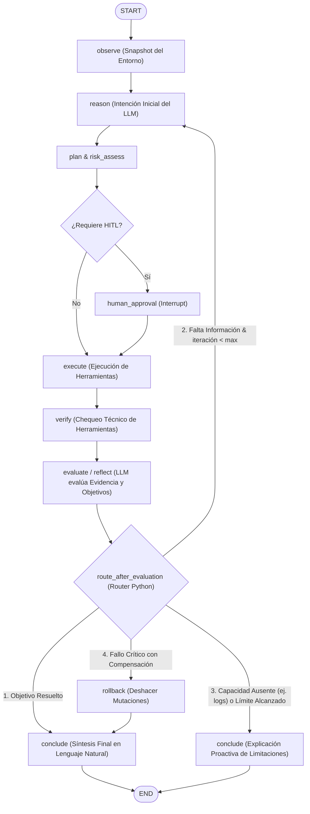

# Plan de Implantación: Razonamiento Iterativo y Bucles de Pensamiento Proactivos

**Proyecto:** `jg_agente` (con soporte en `jg_dashboard`)  
**Fecha:** 12 de Septiembre de 2026  
**Línea base:** Tag `v0.9`  
**Referencia de auditoría:** [`jg_agente/docs/issues/20260912-audit/audit/looping/ESTUDIO_ARQUITECTONICO_RAZONAMIENTO_ITERATIVO.md`](../issues/20260912-audit/audit/looping/ESTUDIO_ARQUITECTONICO_RAZONAMIENTO_ITERATIVO.md)

---

## 1. Visión y Objetivos Arquitectónicos

Actualmente, el flujo de ejecución en `jg_agente` es estrictamente lineal:
```
START → observe? → reason → plan? → risk_assess? → human_approval? → execute → verify? → conclude → END
```
Si el agente ejecuta una herramienta (como `docker:list`), el nodo terminal `conclude` toma la salida técnica directa (un volcado JSON crudo) y la devuelve al operador humano. Además, si tras observar el estado el agente se da cuenta de que algo está fallando o que necesita más información, no tiene capacidad de dar un paso atrás, evaluar la situación ni encadenar una segunda acción diagnóstica.

### Objetivos Principales:
1. **Inteligencia y Decisión en el LLM (Semántica):** El agente debe evaluar semánticamente si la salida de las herramientas resuelve la petición del usuario, utilizando el mismo modelo LLM configurado en el agente (Groq `openai/gpt-oss-120b` vía `get_llm()`).
2. **Seguridad y Guardarraíl Determinista (Python):** El router de LangGraph controla los límites operativos (`max_iterations`, presupuesto de llamadas, prevención de loops infinitos) sin delegar el control de terminación exclusivamente al LLM.
3. **Capability-Aware Reasoning (Honestidad Operativa):** Si para resolver el objetivo el agente necesita una herramienta inexistente en su catálogo (ejemplo: detectar un contenedor reiniciándose y necesitar `docker:logs`, que no está implementada en el proxy), debe concluir proactivamente explicando qué descubrió y señalando explícitamente qué capacidad técnica le falta para continuar.
4. **Cero Salidas JSON Crudas:** La respuesta final para el humano siempre debe estar sintetizada y redactada en lenguaje natural claro y conciso.

---

## 2. Diagrama de la Nueva Topología del Grafo



---

## 3. ¿Un Solo Issue o Varios Issues?

### Recomendación: Dividir en **3 Issues Incrementales** (Epic: `EPIC-LOOPING-01`)

Acometer todo en un único commit/issue masivo introduce un alto riesgo de regresión en los 251 tests del dashboard y los 41 tests del agente, dificultando el aislamiento de fallos en el checkpointer de LangGraph o en la gobernanza HITL.

Estructurarlo en **3 issues modulares** garantiza que cada fase deje la suite de tests al 100% en verde:

| Issue | Alcance | Entregable Clave |
|---|---|---|
| **ISSUE-AGENT-008** | **Estado, Contratos y Presupuestos** | `AgentState` enriquecido con `iteration`, `max_iterations`, `observations_history`, y soporte en serializador Postgres/Memory. |
| **ISSUE-AGENT-009** | **Nodo de Evaluación y Capability-Awareness** | Nuevo nodo `evaluate_node` que invoca al LLM activo para emitir un veredicto estructurado (`goal_status`, `next_action`, `missing_capability`). |
| **ISSUE-AGENT-010** | **Aristas Cíclicas en LangGraph, Guardarraíles y Síntesis** | Router `route_after_evaluation`, arista de retorno a `reason`, formateo en lenguaje natural en `conclude` y trazabilidad por iteración en la Consola. |

---

## 4. Detalle de los Issues

### ISSUE-AGENT-008: Contratos, Estado y Preparación de Mensajes

- **Objetivo:** Dotar a `AgentState` de los campos necesarios para seguir múltiples saltos cognitivos sin romper los checkpoints ni las peticiones iniciales.
- **Ficheros a modificar:**
  - `app/models/state.py`:
    - Añadir campo `iteration: int` (default 1).
    - Añadir campo `max_iterations: int` (default 3, configurable vía settings/request).
    - Añadir modelo estructurado `EvaluationRecord`:
      ```python
      class GoalStatus(str, Enum):
          SATISFIED = "satisfied"
          NEEDS_MORE_INFO = "needs_more_info"
          BLOCKED_MISSING_CAPABILITY = "blocked_missing_capability"
          FAILED = "failed"
      ```
    - Añadir acumulador `evaluation_records: Annotated[list[EvaluationRecord], operator.add]`.
  - `app/core/checkpointer.py`:
    - Registrar los nuevos tipos en la allowlist de serialización para garantizar persistencia limpia en `DualPostgresSaver`.
  - `app/nodes/execute.py`:
    - Garantizar que los resultados de pasos planificados también se transformen en mensajes tipo `ToolMessage` en `state["messages"]`, para que la siguiente iteración de `reason` los lea directamente.
- **Criterio de Aceptación:** Todos los tests de checkpointer y modelos pasan al 100%.

---

### ISSUE-AGENT-009: Nodo de Evaluación Semántica (`evaluate_node`) y Capability-Awareness

- **Objetivo:** Permitir que el LLM activo razone sobre los resultados técnicos obtenidos, determine si la meta del usuario está satisfecha o si faltan capacidades.
- **Ficheros a modificar/crear:**
  - `app/nodes/evaluate.py` (Nuevo nodo):
    - Invoca al LLM configurado (`get_llm()`).
    - Recibe:
      1. El prompt original del usuario (`request.prompt`).
      2. El snapshot del entorno (`environment_snapshot`).
      3. Los registros de ejecución de herramientas (`execution_records`).
      4. El catálogo de capacidades activas del agente (`registry.get_tools()`).
    - Instrucción al LLM (System Prompt):
      > *"Evalúa si con la información recopilada se responde exhaustiva y claramente al usuario. Si detectas una anomalía que requiere herramientas adicionales (ej. logs, métricas detalladas), verifica si están presentes en las capacidades disponibles. Si NO están presentes, declara 'BLOCKED_MISSING_CAPABILITY' y redacta la explicación proactiva para el operador humano."*
    - Devuelve una estructura validada con Pydantic (`EvaluationResult`).
- **Criterio de Aceptación:** Tests unitarios de `evaluate_node` con casos: meta cumplida, necesidad de otra herramienta existente, y necesidad de herramienta no disponible.

---

### ISSUE-AGENT-010: Topología Cíclica en LangGraph, Router de Seguridad y Síntesis Final

- **Objetivo:** Conectar el ciclo en `GraphBuilder`, establecer los guardarraíles de parada y erradicar respuestas en formato JSON crudo.
- **Ficheros a modificar:**
  - `app/core/graph.py`:
    - Añadir nodo `evaluate` tras `verify` (o tras `execute` si no hay verifier).
    - Añadir arista condicional `route_after_evaluation`:
      ```python
      def route_after_evaluation(state: AgentState) -> str:
          # Guardarraíl 1: Si hay fallo fatal con compensación -> rollback
          if state.get("requires_rollback"):
              return "rollback"
          
          eval_rec = state.get("evaluation_records", [])[-1]
          
          # Guardarraíl 2: Límite de iteraciones alcanzado
          if state.get("iteration", 1) >= state.get("max_iterations", 3):
              return "conclude"
              
          # Guardarraíl 3: Falta de capacidades -> concluir explicando
          if eval_rec.goal_status == GoalStatus.BLOCKED_MISSING_CAPABILITY:
              return "conclude"
              
          # Decisión del LLM
          if eval_rec.goal_status == GoalStatus.NEEDS_MORE_INFO:
              return "reason"
              
          return "conclude"
      ```
  - `app/nodes/reason.py`:
    - Al iniciar una iteración `> 1`, incrementar contador `iteration += 1` e incorporar al prompt del LLM la síntesis de la evaluación previa.
  - `app/nodes/conclude.py`:
    - **Prohibir volcado de JSON crudo**: Priorizar siempre la síntesis generada por el nodo de evaluación. Si la salida técnica fue `{"containers": [...]}`, la respuesta al usuario será la explicación redactada por el LLM.
  - `jg_dashboard` (Frontend / Visualización):
    - Asegurar que la traza de pasos en la Consola agrupe o identifique claramente los pasos pertenecientes a cada iteración (`Iteración 1: docker:list`, `Iteración 1: evaluate`, `Iteración 2: conclude`).
- **Criterio de Aceptación:**
  - Pregunta *"¿cómo están los contenedores?"* devuelve una respuesta redactada en lenguaje natural impecable.
  - Ante un contenedor caído sin herramienta de logs, el agente explica el estado y sugiere proactivamente la necesidad de dicha herramienta sin entrar en bucle infinito.
  - 100% de la suite Pest (251 tests) y Pytest (41+ tests) en verde.

---

## 5. Matriz de Riesgos y Mitigaciones

| Riesgo | Impacto | Mitigación |
|---|---|---|
| Bucle infinito por alucinación del LLM | Alto (Coste y timeout) | Guardarraíl estricto en Python: `iteration >= max_iterations` fuerza salida a `conclude`. |
| Latencia elevada por múltiples llamadas | Medio | `max_iterations` por defecto en 3; el evaluador concluye en 1 salto si la pregunta era simple. |
| Incompatibilidad con Checkpoints anteriores | Medio | Nuevos campos de `AgentState` con valores por defecto opcionales; compatibilidad hacia atrás garantizada. |
| Repetición de acciones no idempotentes | Alto | Las herramientas de mutación (ej. restart) solo se permiten en el primer plan salvo confirmación explícita. |
